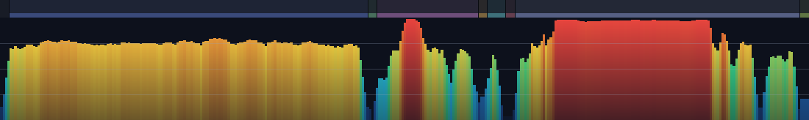

# entropy-map

**See what a binary is doing before you run it.** Sliding-window Shannon entropy over any file,
rendered as a heatmap, with PE/ELF section overlays, embedded-object carving and string triage.

Pure Python standard library: the PNG writer, the PE and ELF parsers and the entropy engine are
all here, no `matplotlib`, no `numpy`, no `pyelftools`.



*notepad.exe: code and data plateau, a compressed stretch, then the resource section as a
near-solid red block. The band on top is the PE section map.*

```
$ python main.py analyze suspicious.exe
┌─ suspicious.exe
    size        352 KB
    container   PE
    class       code / structured data
    entropy     5.67 bits/byte  peak 7.96
    grid        349 windows of 4 KB, step 1 KB

  high-entropy regions  (packed / compressed / encrypted)
  offset      length  peak  ratio
  ──────────  ──────  ────  ────────────────────
  0x0002b800    7 KB  7.96  ####################
  0x0003bc00   68 KB  7.92  ####################

  embedded objects
  offset      type       size   ext
  ──────────  ─────────  ─────  ───
  0x0003bc48  PNG image  70 KB  png
```

---

## Why

Packed, encrypted and compressed data all look alike to a scanner: high entropy, no strings, no
structure. A map makes the shape obvious in one second:

- a **flat red plateau** across most of the file, or an executable section at 7.9 bits/byte, is a
  packer or a crypter;
- a **thin red band inside an otherwise readable file** is an embedded archive, a payload or a
  resource;
- a **large empty region** is padding, a sparse table or a section that never got filled;
- **green text regions** are config, scripts or embedded source.

## Install

Python 3.10+, nothing else.

```bash
git clone https://github.com/Pajt9whauht283as/entropy-map
cd entropy-map
python main.py analyze something.bin
```

Or as a command:

```bash
pip install .
entropy-map analyze something.bin
```

## Commands

| Command | What it does |
|---|---|
| `analyze <file>` | profile + heatmap + sections + carve + optional strings |
| `sections <file>` | PE or ELF section table with per-section entropy |
| `carve <file>` | embedded files found by signature, with offsets and sizes |
| `strings <file>` | ASCII and UTF-16LE strings, `--interesting` for URLs, paths, keys |

Useful flags:

| Flag | Meaning |
|---|---|
| `--window N` | entropy window in bytes (default 4096) |
| `--step N` | window advance (default window/4) |
| `--width`, `--height` | image size (default 1600x180) |
| `--png FILE` / `--no-png` | output path, or skip rendering |
| `--threshold 7.2` | high-entropy cutoff in bits/byte |
| `--strings` | also extract strings |
| `--no-carve` | skip signature carving |
| `--json` | machine-readable dump |

Examples:

```bash
python main.py analyze pack.zip --strings --json
python main.py analyze client.dll --width 2400 --height 260 --png client.png
python main.py sections client.dll
python main.py carve dump.bin
python main.py strings dump.bin --interesting
```

## How it works

**Entropy.** Each window gets a Shannon entropy in bits per byte:

```
H = -Σ p(b) · log2 p(b)      b over 0..255
```

0 means a single repeated byte, 8 means indistinguishable from random. Windows larger than 2 KiB
are sampled evenly (C-level slicing) so a 100 MB file stays fast: an 82 MB archive profiles in
about a second.

**Grid sizing.** The scan keeps the window grid bounded (8192 windows). Large files switch to
non-overlapping tiles so every byte is read once instead of re-reading overlaps.

**Regions.** Contiguous runs above the threshold (default 7.2) are reported as packed/compressed/
encrypted candidates; runs below 0.5 are reported as empty space.

**PE.** DOS header, `e_lfanew`, COFF header, optional header size, then 40-byte section records:
name, raw offset, raw size, characteristics decoded into `code / readable / writable / …`.

**ELF.** Class and endianness from the identification bytes, then the section header table, with
names resolved through `shstrtab`. `SHT_NOBITS` sections are reported with zero entropy because
they have no file payload.

**Carving.** Magic signatures (PNG, JPEG, GIF, ZIP, 7z, RAR4/5, gzip, bzip2, xz, PDF, OLE,
SQLite, PE, ELF, DEX, tar) with size resolution where the format allows it: PNG walks the chunk
chain to `IEND`, ZIP finds the end-of-central-directory record, JPEG scans for `FFD9`. Candidates
are validated before they are reported — an `MZ` inside code is not a PE unless `e_lfanew` really
points at `PE\0\0`.

**Strings.** Two passes, one for printable ASCII runs, one for UTF-16LE. A UTF-16 match that
starts on the tail of an ASCII run is trimmed, which is the usual source of `dwide string`-style
false positives.

## Demo and tests

The screenshots are generated, not hand-made:

```bash
python tools/demo.py                       # writes docs/demo.png from a synthetic sample
python main.py analyze C:\Windows\System32\notepad.exe --png docs/notepad.png
python -m unittest discover -s tests -v    # 17 tests, no network, no fixtures needed
```

The test suite builds everything it needs: a minimal PE, a PNG embedded in random bytes, a
UTF-16 string after an ASCII run, and synthetic entropy profiles.

## What this does not tell you

Entropy is a shape, not a verdict. A compressed resource and an encrypted payload both sit at
7.9 and cannot be told apart without code analysis. A short file gives noisy windows. A packer
that stores its stub uncompressed will look half-normal. The map tells you where to look and
what is worth opening in a disassembler; it does not replace one.

## License

MIT.
